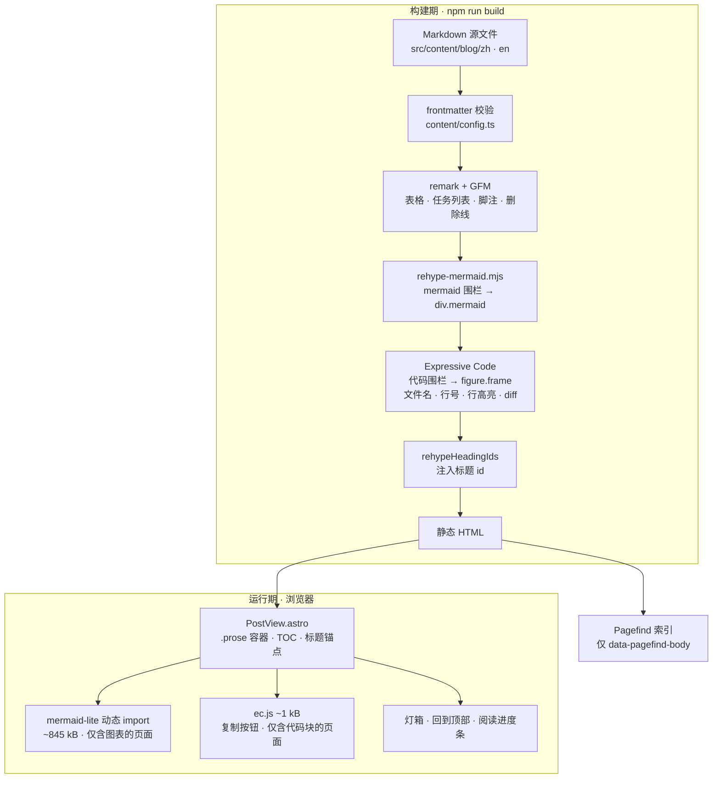

# AGENTS.md

Astro 5 static site (零 JS 默认). Commands: `npm run dev` (localhost:4321), `npm run build`, `npm run preview`, `npm run check` (`astro check`, currently 0 errors). There is **no** lint / test script — do not look for or invent them.

Project: 中文「今时录」/ 英文「NowBlog」；标语「记录此刻，留存当下」。Directory: `now-blog`.

## Build & verification

- `npm run build` runs `astro build && pagefind --site dist`. Pagefind search index is generated **only** at build time. A clean build produces 87 HTML files and indexes 29 pages across 2 languages; those counts moving is a signal, not an error.
- `npm run check` must stay at 0 errors after touching `src/lib/mermaid-lite.ts` or the i18n key set.
- **Only search is broken under `dev`.** Code highlighting (Expressive Code), Mermaid diagrams, the archive (`/blog/archive/`) and the article client JS (lightbox, TOC, back-to-top) all work in `npm run dev`. `/search` shows a placeholder because the index does not exist yet — verify search with `npm run build && npm run preview`.
- Use `src/content/blog/{zh,en}/rendering-showcase.md` as the smoke test: it covers every element the pipeline supports.

## Rendering pipeline



**顺序敏感**：`rehype-mermaid` 必须排在 Expressive Code **之前**，这样 mermaid 围栏被接管时还是个普通的 `<pre>`（详见 [Mermaid diagrams](#mermaid-diagrams)）。

## Search indexing (Pagefind)

- Only the article body is indexed: `PostView.astro` wraps `<Content />` in `<div class="prose" data-pagefind-body>`. Title/description/author (as `data-pagefind-meta`) and tags + category (as `data-pagefind-filter`) are indexed from the header region **outside** that div — they work because Pagefind captures meta/filter anywhere on the page.
- Results are per-locale: `/search` queries zh index, `/en/search` queries en index.
- No other `data-pagefind-meta`/`data-pagefind-filter`; list/archive/tag/category/home pages are excluded via `pagefind-ignore` (Layout default `indexable=false`).

## i18n / content

- Default locale `zh` has **no** URL prefix; English lives under `/en`. Config in `astro.config.mjs` (`prefixDefaultLocale: false`).
- **Every page lives under `src/pages/[...locale]/`** — 404 included (`404.astro` there serves `dist/404.html` and `dist/en/404/`). There are no `src/pages/en/**` mirrors any more; adding a page means one file plus `getStaticPaths` from `localePaths()`.
- Blog posts live in `src/content/blog/zh/` and `src/content/blog/en/`. A post with a counterpart in the other locale needs **the same slug** in both; mismatched slugs break language switching. Posts that exist in only one locale are fine: `PostView.astro` passes `langMissing` to `LangSwitch`, which points that locale at its blog index and dims the link (`lang.missing` tooltip) instead of 404ing. Schema in `src/content/config.ts` includes optional `cover` (image path under `public/`), optional `draft` (boolean), and optional `category` (a category **id** from `src/data/categories.ts`).
- UI strings (incl. long `about.bio` HTML and `brand`): `src/i18n/ui.ts`. Every key must exist in **both** `zh` and `en` — the `en` block is typed against the `zh` key set, so a missing translation is a `astro check` error, not a runtime blank. Blog helpers (filter/sort/paginate/archive/related/reading time): `src/i18n/content.ts`. Per-locale RSS: `src/i18n/rss.ts` → `/rss.xml`, `/en/rss.xml`.
- `src/i18n/routing.ts` is the single place that knows about URL prefixes: `prefix(locale)`, `localeFrom(params)`, `localePaths()` (for `getStaticPaths`) and `forEachLocale()`. Do not hand-roll `/en` string concatenation in a page or component — `content.ts` already provides `tagHref` / `authorHref` / `categoryHref` / `blogHref` for links.
- Classification model: categories are defined in `src/data/categories.ts` (`id` + zh/en labels; append there to add one). Current categories: `vibe-coding` / `app` / `bookkeeping` / `tech-talk`. Frontmatter `category` references an id — an unregistered id **fails the build**. URLs use the id (`/categories/vibe-coding/`, `/en/categories/app/`), pages display the localized label. Category routes live in `src/pages/[...locale]/categories/` (`index.astro` + `[category].astro` + `[category]/rss.xml.ts`) like every other locale-aware route — note that a `[...locale]` folder page still needs `getStaticPaths` (use `localePaths()`). One category per post; `tags` = fine-grained labels (`/tags/`); `series` + `seriesOrder` = ordered docs inside one project. zh/en UI keys (`cats.*`, `nav.categories`, `post.category`) must stay in sync in `ui.ts`.
- `draft: true` or future `pubDate` → excluded in `build`, kept in `dev` (see `getPosts`).

## Reading-experience features (article pages only)

All client JS is scoped to `PostView.astro` and degrades gracefully:
- Reading progress bar: pure CSS `animation-timeline: scroll()` (zero JS).
- TOC from `render(post).headings` (h2/h3 only) with IntersectionObserver scroll-spy — the spy observes h2/h3 **only**, because an observed h4 would clear the highlight without ever setting a new one. Copyable anchor links are injected into h1–h4, though only h2/h3 appear in the TOC.
- Back-to-top button; image lightbox. (The code copy button belongs to Expressive Code — see the next section.)
- The `mailto` button lives in `AuthorCard.astro` (not Hero, not About); its address comes from `SITE_EMAIL` in `src/consts.ts`.

## Code blocks (Expressive Code)

Code blocks come from [Expressive Code](https://expressive-code.com/) through the `astro-expressive-code` integration in `astro.config.mjs`. It replaces Astro's built-in Shiki highlighting, so `markdown.shikiConfig` is gone and there is no `.astro-code` element any more.

- Output shape: `<figure class="frame">` → `<figcaption class="header">` (file name) + `<pre>` → `<div class="ec-line">` → `<div class="code">`. Expressive Code applies `all: revert` inside its own subtree, so **do not restyle `pre`/`code` under `.prose`** — only the block's outer margin is ours (`.prose :global(.expressive-code)`).
- Features come from the fence meta string, e.g. ```` ```ts title="src/lib/lru.ts" showLineNumbers {2-4} /term/ ```` for file name, line numbers, line highlighting and text markers. Line numbers require `@expressive-code/plugin-line-numbers`, registered via `plugins: [...]`; without it `showLineNumbers` is silently ignored.
- Line numbers and highlight ranges are **relative to the block**, not to the source file.
- Themes: `themes: ["github-light", "github-dark"]` with `useDarkModeMediaQuery: false` and a `themeCssSelector` mapping onto this site's `html[data-theme="light|dark"]`. `Layout.astro`'s inline script always sets that attribute, so blocks follow the site toggle rather than the OS.
- The copy button (with its `aria-live` announcement) is Expressive Code's own; it adds a ~1 kB `ec.*.js` module to pages that contain code blocks.
- `src/content/blog/{zh,en}/rendering-showcase.md` is a sample post exercising every element — typography, tables, all code-block features, both diagram types, task lists and footnotes. Re-check it after touching the pipeline.

## Mermaid diagrams

Author diagrams with a ```mermaid fence. Two pieces make them work:

- **Build time** — `src/plugins/rehype-mermaid.mjs` (registered as `markdown.rehypePlugins` in `astro.config.mjs`) rewrites the block into `<div class="mermaid" data-pagefind-ignore="all">`, so there is no flash of source code. It must stay registered **before** Expressive Code, so the fence is still a plain `<pre>` when it runs; the plugin reads the language off that `<pre>` (`data-language="mermaid"`), because the `<code>` element carries no `language-*` class.
- **Run time** — `PostView.astro` dynamically imports `src/lib/mermaid-lite.ts` (not `mermaid` itself) only when the page contains `.mermaid`; posts without diagrams never download it. That module reuses mermaid's core and registers just the **flowchart** (`graph` / `flowchart`) and **sequence** renderers, so a diagram page executes ~845 kB / ~214 kB gzip instead of eagerly pulling in all ~50 diagram types (cynefin/cytoscape, KaTeX, gantt, …). Theme follows `html[data-theme]` and repaints on `theme-change`.
  - Adding a diagram type means importing its renderer chunk and adding a detector in `src/lib/mermaid-lite.ts` (see the comment at the top of the file); an unregistered type now throws `UnknownDiagramError` rather than rendering.
  - The chunk filenames it imports (`flowDiagram-HODETNUW.mjs`, `sequenceDiagram-WJ2MYXX4.mjs`, `chunk-DU6HZSFF.mjs`) are hashed by mermaid and **do change between versions** — bump them together with the `mermaid` dependency. `src/types/mermaid.d.ts` declares the deep imports so `astro check` stays clean.
  - `mermaid.core` still lists every renderer in its internal lazy table, so those files stay in `dist/_astro`; they are simply never requested.

Diagram source is excluded from the Pagefind index via `data-pagefind-ignore`.

**Gotcha:** Astro caches rendered collection content in `node_modules/.astro`, keyed on file contents. After editing *only* the rehype plugin, existing posts will not re-render — `rm -rf node_modules/.astro` (or bump the markdown config) to force it.

## Fonts (self-hosted, no CDN)

Imported via Fontsource in `Layout.astro` frontmatter: `@fontsource/noto-serif-sc` (Chinese serif tagline) + `@fontsource/tangerine` (English script). Hero tagline styled in `Hero.astro` `.lead` (gradient text). CJK ships as on-demand slices, so only used glyphs download.

## Pre-deploy (repo-specific gotchas)

- Change `site` in `astro.config.mjs` **and** the `Sitemap:` line in `public/robots.txt` together (both are currently `https://nowblog.pages.dev`) — RSS/sitemap URLs depend on them.
- Replace identity: `brand` + `about.bio` in `src/i18n/ui.ts`, `SITE_TITLE/SITE_BRAND/SITE_DESCRIPTION/SITE_EMAIL` in `src/consts.ts`, `Hero.astro` / `AuthorCard.astro` avatar initials, and post `author` frontmatter.
- Contact email is centralized in `SITE_EMAIL` (`src/consts.ts`); `AuthorCard.astro` renders it as the `mailto:` button.
- Giscus is **enabled** for `skiray/now-blog`, while `public/admin/config.yml` says `repo: skiray/NowBlog` — GitHub repo names are case-insensitive so both resolve, but if you rename or transfer the repo, update **both** files. To change repo/category, edit the `GISCUS` object in `src/components/Giscus.astro`; reverting any value to a `your-` prefix disables it again.

## Content editor (Decap CMS at `/admin`)

- `public/admin/index.html` loads Decap CMS from jsDelivr, pinned to an exact version **with an SRI hash**; the bundle is no longer committed. Bumping the version means recomputing the `integrity` value (the comment in that file has the one-liner).
- `public/admin/config.yml` uses the `github` backend with `base_url` + `auth_endpoint: /auth`. The OAuth round trip is served by two Cloudflare Pages Functions: `functions/auth.js` (redirect to GitHub) and `functions/callback.js` (code → token, posted back to the popup).
- Secrets: `GITHUB_CLIENT_SECRET` must be a Pages environment variable; `GITHUB_CLIENT_ID` / `SITE_ORIGIN` are optional and documented in `.env.example`. The GitHub OAuth app's callback URL must be `https://<domain>/callback`.
- `functions/` is excluded from `tsconfig.json` and is not part of `astro build`; it only runs on Cloudflare (or `wrangler pages dev`).

## Legal pages

- `/privacy` + `/terms` (and `/en/privacy`, `/en/terms`) come from `src/pages/[...locale]/{privacy,terms}.astro`, which both render the shared `src/components/LegalPage.astro`.
- Their copy lives in `src/i18n/ui.ts` (`privacy.*` / `terms.*`); the "last updated" date is `LEGAL_UPDATED` in `src/consts.ts`. Bump it whenever the text changes.
- Both inherit `Layout`'s default `indexable=false`, so Pagefind skips them, but they do appear in the sitemap.

## Docs

- `README.md` is the user-facing guide (功能 / 技术栈 / 本地开发 / 内容管理 / 部署 / 目录结构 / 新增文章). `AGENTS.md` is the maintainer/agent handbook. Both must be updated in the same change that alters routes, scripts, or the content workflow — a stale directory tree is the most common drift here.
- Facts worth keeping in sync by hand: build output counts (87 HTML / 29 indexed pages), the `mermaid-lite` byte budget, the category id list.

## Conventions

- **Astro scoped styles never match runtime-created elements.** Astro appends `[data-astro-cid-*]` to every selector in a component `<style>`, so markup built with `document.createElement` gets no styles at all unless the selector is wrapped in `:global(...)`. This already bit the lightbox overlay, the heading anchors, and the Pagefind result cards on `/search`; keep it in mind for any new client-injected element.
- Markdown body elements (`hr`, `h1`, `h4`…) are rendered by `<Content />`, so they carry no scope attribute either — style them as `.prose :global(tag)`.
- Post bodies should not start with a `# ` H1: the page already renders the title as the only `<h1>`.
- Styles/design tokens: `src/styles/global.css`. Layout skeleton + theme + SEO + font links: `src/layouts/Layout.astro`.
- Theme toggle is system-aware with persisted choice and anti-flash handling; keep intact when editing `<head>`.
- Deploy outputs `dist/`. Hosts (Vercel/Netlify/Cloudflare Pages/GitHub Pages) just need build `npm run build` + dir `dist/`.
